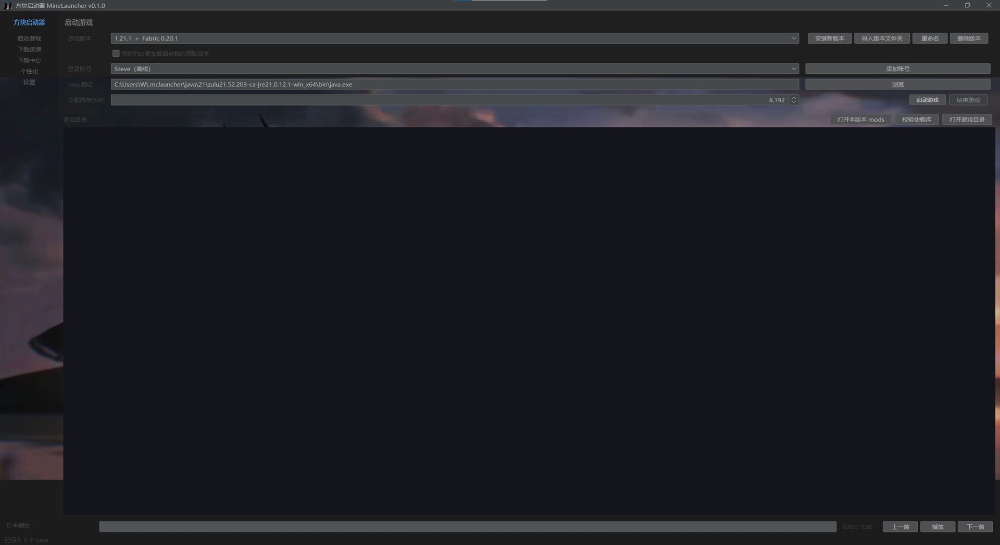
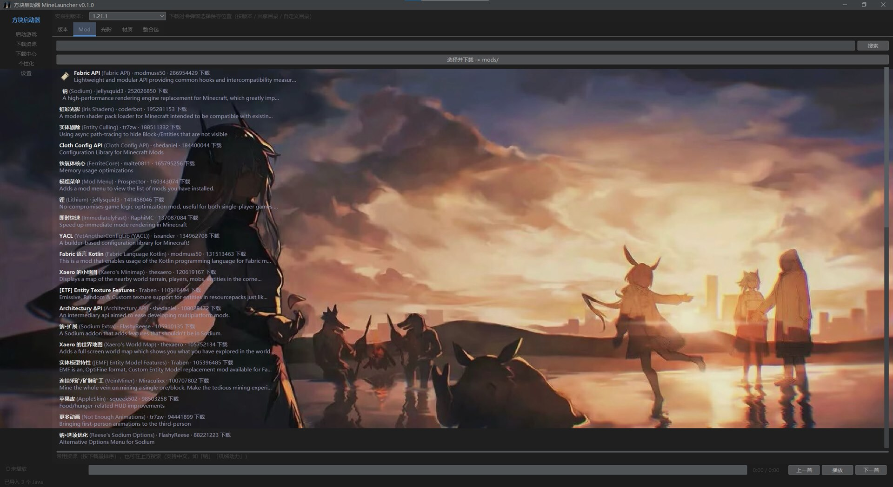
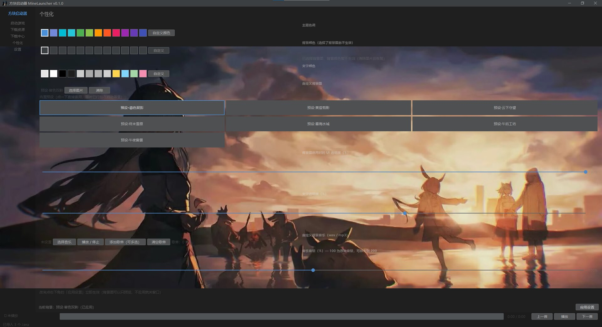
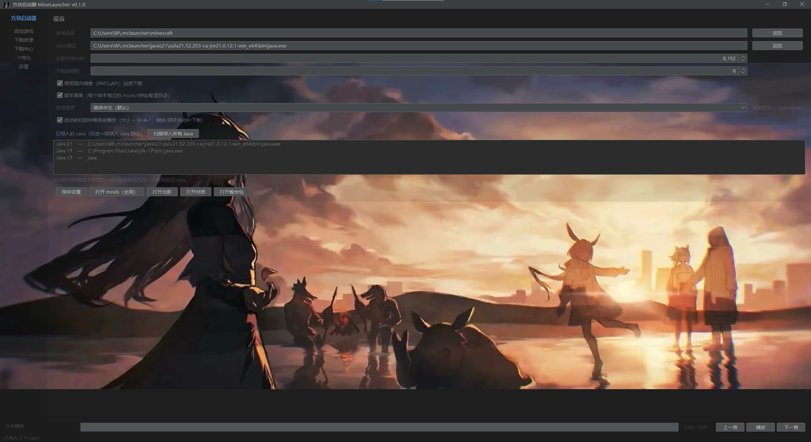

# MineLauncher · 方块启动器

> 一个用 **Java 17 + Swing** 编写的 Minecraft 启动器：原版 / Forge / NeoForge / Fabric / Quilt 一键安装，
> 整合包拖拽导入、依赖库 SHA-1 完整性校验、国内镜像加速、中文名与中文搜索全部就绪。

**不是** PCL2 的二改、也**不是**官方启动器：项目参照 HMCL / Prism Launcher 等开源实现，从零实现同等的核心功能，
UI 与交互按中文用户习惯重新设计（PCL2 本身闭源，本项目不包含其任何代码）。

```
Java 17 + Swing · 无第三方框架（仅 Gson / FlatLaf / JLayer）· 单文件可执行（自带精简 JRE）
```

## 目录

- [界面预览](#界面预览)
- [功能一览](#功能一览)
- [快速开始](#快速开始)
- [构建与打包](#构建与打包)
- [自检命令](#自检命令)
- [数据与目录](#数据与目录)
- [说明与免责](#说明与免责)

## 界面预览

<table>
  <tr>
    <td width="50%"><a href="docs/screenshots/01-launch.jpg"></a><br>
      <sub><b>启动页</b>　装了加载器后版本合并成「1.21.1 + Fabric 0.20.1」一条；支持导入版本文件夹、重命名、校验依赖库</sub></td>
    <td width="50%"><a href="docs/screenshots/02-mods.jpg"></a><br>
      <sub><b>下载资源</b>　热门 Mod 自动加载，中文名取自 MC 百科（钠 / 铟 / 虹彩光影 …），顶部可直接搜中文</sub></td>
  </tr>
  <tr>
    <td><a href="docs/screenshots/03-personalization.jpg"></a><br>
      <sub><b>个性化</b>　主题色、7 张内置背景预设、面板 / 文字透明度、自定义音乐歌单</sub></td>
    <td><a href="docs/screenshots/04-settings.jpg"></a><br>
      <sub><b>设置</b>　游戏目录、Java 自动识别与导入、内存、BMCLAPI 镜像、版本隔离、启动前校验依赖库</sub></td>
  </tr>
</table>

## 功能一览

- **账号**：离线登录 / 微软正版（设备码 + 浏览器双通道自动降级、令牌自动刷新）/ LittleSkin 外置登录
- **版本**：拉取 Mojang 清单安装原版；Fabric、Quilt 走官方 meta；Forge 走官方安装器；NeoForge 手写 processor 流程
- **整合包**：Modrinth `.mrpack`、CurseForge zip（按 manifest 自动下 mod）、普通 zip、已解压实例目录；
  支持**拖拽导入**，装完自动注册为可独立启动的实例
- **下载**：BMCLAPI 镜像加速、断点续传、卡死自愈、失败换源重试、实时网速与「还剩几个文件」
- **可靠性**：启动前校验依赖库（大小 + SHA-1）、资源文件、FML 本体 jar 与版本 jar，缺什么补什么
- **体验**：Mod / 光影 / 材质 / 整合包自动加载热门列表，**中文名取自 MC 百科**，**支持中文搜索**
- **个性化**：主题色、背景色/图（7 张内置预设）、透明度、自定义音乐歌单

一个用 **Java 17 + Swing** 编写的 Minecraft 启动器，功能对齐 PCL2 的核心体验，对接 Mojang / BMCLAPI / Modrinth / Fabric / Forge 等公开接口。

> 说明：PCL2 本身是闭源软件，本项目**不是**基于 PCL2 源码，而是参照开源启动器（HMCL / Prism Launcher）的实现思路，重新实现相同功能。

## 快速开始

1. 到 [Releases](../../releases) 下载 `MineLauncher-*-win-x64.zip`，解压后双击 `MineLauncher.exe`（自带精简 JRE，无需安装 Java）
   - 也可以自己构建，见 [构建与打包](#构建与打包)
   - **整个文件夹要一起保留**（exe 依赖同目录的 `runtime\` 与 `app\`）
2. 「启动游戏」页默认已有一个离线账号，可点「添加账号」换成微软正版或外置登录
3. 「下载资源 → 版本」安装游戏，或「下载资源 → 整合包」搜索 / **直接拖入整合包文件**
4. 回「启动游戏」选版本 → 开玩

配置、账号、下载的版本都在 `%USERPROFILE%\.mclauncher\`，**删掉程序文件夹不会丢配置**。

## 已实现功能

- **账号登录**
  - 离线登录（任意用户名，按 Mojang 规则生成稳定 UUID）
  - 微软正版登录，**双通道自动降级**，保证始终可用：
    1. **设备代码流**（Azure AD → Xbox Live → XSTS → Minecraft）：弹窗显示代码，浏览器输入即可，无需粘贴
    2. **浏览器登录流**（`login.live.com`）：当设备码通道在当前网络/租户不可用（`unauthorized_client` / `AADSTS700016`）时自动降级——
       自动打开微软登录页，登录后把浏览器地址栏整条链接粘回来即可
       - 默认走 **隐式流**（`response_type=token`，令牌直接在链接 `#` 片段里返回，**不需要二次换票**，最稳）
       - 可切换成 **授权码流**（`response_type=code`）作为备选
  - 两条通道统一保存 `refresh_token` 与过期时间，**启动前自动刷新**（提前 5 分钟），令牌过期也不会掉登录
  - **LittleSkin 外置登录**（Yggdrasil 协议 + 自动下载 authlib-injector），可进入皮肤站服务器、显示皮肤
- **版本下载与启动**
  - 拉取 Mojang 版本清单（含快照开关、搜索）
  - 下载并安装任意版本：客户端 jar、依赖库、资源文件、日志配置
  - 支持国内镜像（BMCLAPI）加速，可在设置里开关
  - 自动解析规则（操作系统 / 架构 / 新旧两种 natives 格式），支持 1.7.10 到最新版本
  - 拼接 classpath、解压 natives、替换 `${...}` 占位符、拉起 `java` 进程并显示日志
- **版本安装（含加载器，PCL2 式流程）**
  - 在「下载资源 → 版本」搜索并选中版本 → 点击「选择此版本并安装」→ 跳到安装页
  - 安装页可选择：**原版** / **Fabric** / **Forge** / **NeoForge**，选中加载器后会自动拉取加载器版本列表
  - **Fabric**：走官方 meta API，直接下载 loader profile 并继承原版，速度快
  - **Forge**：下载官方安装器并 `--installClient` 安装，支持 `--mirror` 国内镜像加速
  - **NeoForge**：手写执行安装器的 processor 流程（installertools / jarsplitter / AutoRenamingTool / binarypatcher），依赖库全部经 BMCLAPI 下载，不依赖 `maven.neoforged.net`；失败时自动回退到官方安装器 `--installClient`
  - **Quilt**：走 Quilt 官方 meta API，下载 loader profile 并继承原版
  - **OptiFine**：从 BMCLAPI 下载 OptiFine jar 到 `mods/`（需 Forge 加载器生效；独立版需官方图形安装器）
  - **下载位置可选**：点下载时弹窗选择保存位置 —— 某个版本（版本隔离时列出全部已装版本，直接下到 `instances/<版本>/mods`）/ 共享目录 / 自定义目录
  - **右键跳转**：Mod / 光影 / 材质 / 整合包列表上右键，可直接在 **MC 百科** 或 **CurseForge** 搜索该资源
- **版本隔离**
  - 每个版本拥有独立的 `instances/<版本>/` 目录（mods、存档、配置、光影、材质互不干扰），方便同时装多个版本
  - 可在「设置」里开关；关闭后 Mod/光影/材质等回到共享目录
  - 启动页有「打开本版本 mods」按钮，直接定位到**当前所选版本实际使用**的 mods 目录（隔离时是 `instances/<版本>/mods`），避免和全局 `mods/` 搞混
  - **版本列表只显示「游戏版本 + 加载器」**：装了 Fabric/Forge/NeoForge/Quilt 之后，下拉里不会再多出一个原版条目，
    而是显示成「1.21.1 + Fabric 0.20.1」这样一条；被加载器依赖的原版默认隐藏，需要时勾选「同时列出被加载器依赖的原版版本」
  - **版本重命名**：启动页「重命名」给任意版本起显示名（只改显示，不动目录名、不影响启动）；留空恢复自动名
  - **删除版本**：启动页「删除版本」按钮，需在弹出的对话框里**手动输入「确认」两个字**才会删（防误触），
    并可选择「只删版本文件夹」或「连实例目录一起删」
- **资源下载**
  - Mod（→ `mods/`）、光影（→ `shaderpacks/`）、材质（→ `resourcepacks/`）
  - **自动加载常用列表**：打开 Mod/光影/材质标签页时，自动拉取「按下载量」的热门列表，无需先搜索
  - **中文名来自 MC 百科**（mcmod.cn，不是机器翻译）：列表直接显示「钠 / 机械动力 / 应用能源2 / JEI物品管理器」这类官方中文名；
    内置常见 Mod 的中文表保证离线可用，没收录的后台查 MC 百科并缓存到 `~/.mclauncher/mcmod-cache.json`，
    再打开就不用联网；确实查不到的才回退英文原名
  - **支持中文搜索**：输入「钠」「机械动力」「应用能源」这类中文时，先到 MC 百科查出对应条目的英文名，
    再按英文名搜 Modrinth，精确命中的排最前（英文关键词仍然直连搜索，不绕道）
  - **中文名 + 图标**：中文名见上，图标从 Modrinth 异步加载
  - **MC 版本 + 资源版本自选**：选中资源后点「选择并下载」，跳到新页面选具体 Minecraft 版本与 mod/光影/材质/整合包版本，再下载
  - **整合包（可独立启动）**：Modrinth `.mrpack` → 自动识别所需的 Minecraft 版本与加载器 → 自动安装原版 + Fabric/Forge/Quilt/NeoForge → 下载文件 + 解压 overrides 到 `instances/<名称>/` → 注册为可启动实例
- **整合包页面与外部整合包导入**
  - 打开「下载资源 → 整合包」**自动加载常用整合包列表**，另有「刷新列表」按钮（以前这页是空的，只能自己搜）
  - **拖拽识别**：把整合包文件直接拖进启动器窗口即可安装，自动认出
    **Modrinth `.mrpack`**、**CurseForge 整合包 zip**（根目录 `manifest.json`）、**带 `mods/` 的普通整合包 zip**、
    **已解压的实例目录**（Prism / MultiMC 的 `mmc-pack.json`、HMCL 那种也认）——认不出会明确告诉你支持哪些格式
  - **「导入整合包文件…」按钮**：不想拖拽时用文件选择框选 `.mrpack` / zip
  - 安装前弹窗确认：显示识别出的类型、Minecraft 版本、加载器、清单文件数、实例目录，确认后才开始装
  - **「已安装整合包…」对话框**：列出已装整合包，可「在启动页选择 / 打开目录 / 删除登记」
  - **overrides 前缀修正**：`.mrpack` / CurseForge 的配置必须落在 `mods/`、`config/` 根下，
    以前会把它们铺成 `instances/<包>/overrides/mods/…`，结果装完游戏里一个 mod 都没有
  - **NeoForge 整合包**现在会真的装 NeoForge 加载器（以前落到 default 分支只装了原版）
  - 装完在实例目录写 `.mclauncher-modpack.json` 标记：**config.json 丢了/被重置，整合包也能自动找回来**
  - 各文件按 sha1 校验（清单给了 sha1 时），下载失败的会在日志里点名是哪个文件
- **整合包实例独立启动**
  - 整合包安装完会出现在「启动游戏」的版本下拉里（前缀 `[整合包]`）
  - 启动时用整合包自己的版本（MC + 加载器）和独立目录（独立的 mods/存档/配置），与其它版本互不干扰
- **下载中心**
  - 侧边栏「下载中心」页面，实时显示正在下载的内容、文件名、进度条、网速、已完成/失败状态
  - 底部状态栏也会显示当前下载与实时网速
- **启动与 Java 自动处理**
  - 启动前自动识别本机 Java（JAVA_HOME / Program Files Java / 启动器下载的 JRE），按版本需求**智能选择**最合适的 Java
  - 设置页「扫描导入所有 Java」一次性列出本机所有 Java，双击即可填入
  - 所需 Java 缺失或过低时，**多源自动下载** JRE 到 `~/.mclauncher/java/<大版本>/`：
    依次尝试 **Azul Zulu CDN（默认，全球 CDN 最稳）→ 清华镜像 → Adoptium GitHub**，某个源连不上就自动换下一个；
    全部失败时给出明确的可操作提示（而不是裸的 `ConnectException`），并提示可在设置里手动指定 java.exe
- **默认中文界面**
  - 启动前自动把游戏 `options.txt` 的 `lang:` 写成 `zh_cn`，进游戏就是中文（其它设置行原样保留，已是中文则不重复写）
  - 设置页「游戏语言」可改为 **简体中文（默认）** / **English (US)** / **跟随游戏（不修改）**
- **崩溃自动导出（完整报告）**
  - 游戏异常退出或产生 crash-reports 时，自动把「崩溃报告 + 本次完整启动日志 launch.log」导出到 `~/.mclauncher/crash-reports/<时间戳-版本>/` 并弹窗提示打开
- **资源完整性校验**
  - 每次启动前核对资源文件（assets），缺失或大小不符的会自动补下载 —— 资源不全正是「界面全英文 / 语言列表空白 / 主菜单没有全景背景」的原因
  - 新下载的文件按内容 SHA-1 校验，坏包不会落盘
  - 单文件下载失败会**自动重试 3 次**，避免一个文件出错就中断整批
- **依赖库完整性校验（大小 + SHA-1）**
  - 每次启动前核对该版本全部依赖库：版本 JSON 给了 `sha1` 就比 SHA-1（能抓出「大小对、内容错」的 jar），只给 `size` 就比大小，
    缺失、截断、内容不符的会被自动删掉重下；都补不上时在日志里点名是哪个库，而不是等游戏崩了再猜
  - 启动页「校验依赖库」按钮可手动全量校验 + 修复，设置页可关闭启动前校验（关掉启动更快）
  - 支持「本地产物」（加载器安装器现场生成的 client-extra 等，没有下载地址）：只核对存在性，缺失时提示重装而不是硬下 404
- **分类器库（classifier）下载修正**
  - 依赖库的地址与落盘路径统一按「artifact → classifiers → maven 约定」解析，**推导时一定带分类器**：
    以前版本 JSON 没有 `downloads` 段时（Fabric / NeoForge 的 version.json、安装器 install_profile 都很常见），
    `org.lwjgl:lwjgl:3.3.3:natives-windows` 会去下主 jar `lwjgl-3.3.3.jar`，再存成 `…-natives-windows.jar`，
    结果 natives 解压不出 `.dll` → 进游戏直接 `UnsatisfiedLinkError: no lwjgl in java.library.path`
  - 老格式 `natives` 里的 `${arch}` 占位符按位数替换成 `64` / `32`（以前是直接删掉，变成不存在的 `natives-windows-`）
  - `os.arch` 规则按「位数」严格匹配（`x86` 只匹配 32 位），32 位机器用 `-x86` 分类器，64 位机器用通用分类器
  - 同一个库被父/子版本重复声明时只下载一次（重复条目会让多个线程同时写同一个 `.part`，把 jar 写坏）
- **FML 本体 jar（NeoForge / Forge `universal`）路径校验**
  - NeoForge / Forge 1.17+ **不通过版本 JSON 的 libraries 加载自己**，而是按 maven 约定直接去
    `libraries/<group>/<artifact>/<version>/<artifact>-<version>-universal.jar` 找本体 jar。
    这个文件缺失时游戏不会提示缺文件，而是报
    `Missing or unsupported mandatory dependencies: Mod ID: 'neoforge' … Actual version: '[MISSING]'`
    加 `java.util.NoSuchElementException: No value present (DisplayWindow.updateModuleReads)`
  - 现在启动前会按 `--fml.neoForgeVersion` / `--fml.forgeVersion` 推出该路径并核对，缺失时优先用本地
    「少了分类器的错名文件」修复（老版本曾把 universal 下成 `neoforge-<ver>.jar`），否则经镜像下载
  - 安装 NeoForge 时也会显式确保该文件存在（processor 流程 + `universal` 坐标）
- **启动参数占位符清理**
  - NeoForge 的 version.json 里带 `--clientId ${clientid}` / `--xuid ${auth_xuid}`，这俩只有官方启动器会填；
    现在会替换成账号 UUID / 空，并在值为空时把整个 `--flag` 丢掉，不再把字面量 `${clientid}` 传给游戏
- **下载性能 / 断点续传 / 卡死自愈**
  - 下载走 `HttpURLConnection`，实测比 `HttpClient` **快 5 倍**（0.83 → 4.03 文件/秒）
  - **断点续传**：下载失败/被打断时保留 `.part`，重试用 `Range` 从断点接着下，不再从头开始；
    续传时 SHA-1 会把已落盘的字节一起算，所以「续传后的文件」一样能校验通过
  - **卡死检测**：单次连接 `12 秒`没有新数据就断开重连；连续两个窗口平均速度低于 `1 KB/s`
    也断开重连 —— 镜像偶尔会「回 200 然后一滴一滴挤」，表现就是进度停在 99%、只有 2 KB/s 且永远不动，
    光靠读超时/重试抓不到这种。重连都有续传兜底，进度不会丢
  - **换源重试**：失败重试时在 **国内镜像 ↔ 官方地址** 之间交替（单个文件镜像慢/5xx 时换官方往往立刻通）
  - **顽固尾巴**：批次下完后再并补一轮，最后对剩下的个别文件串行再补一轮，谁慢也不会拖死整批
  - 资源文件 **32 并发**（小文件吞吐几乎线性取决于并发），下载中心显示实时网速 + **还剩 N 个文件**
  - 慢线路可放宽阈值（越慢越宽容，`0` = 只看「完全没数据」）：
    `-Dmclauncher.stallWindowMs=20000 -Dmclauncher.minRateBps=0`
  - 下载中心支持**取消下载**：立即中止，并删除本轮已下载的文件和所有 `.part` 残留
- **个性化**
  - 侧边栏「个性化」页面
  - **主题色调**：常用色板一键切换 + 自定义取色器（默认蓝色 `#4A90D9`）
  - **背景颜色 / 文字颜色**：常用色板 + 自定义取色器；未选图片时用背景颜色，选了背景图后背景色自动禁用（图片优先）
  - **自定义背景图**：选一张图片铺满启动器背景
  - **UI 透明度**：启用背景图后，UI 面板可设为 20%（默认）左右半透明，背景图透出（下载中心等页面同样生效，不再整块遮挡图片）
  - **文字透明度**：独立滑条（0~90%），与面板透明度分开调节；默认 0% 即完全不透明
  - **启动器图标**：使用 `src/main/resources/icon.ico`（exe 图标）与 `icon.png`（窗口图标）
  - **自定义音乐**：支持 wav / mp3 循环播放

## 目录结构

```
mclauncher/
├── build.gradle                 # 构建脚本（fatJar / exe 任务）
├── build-exe.bat                # 一键打包成 Windows exe
├── gradlew / gradlew.bat        # Gradle wrapper（国内镜像分发）
└── src/main/java/mclauncher/
    ├── App.java                 # 入口（--smoke / --dryrun / --listloaders 等自检）
    ├── auth/                    # 离线 + 微软登录
    ├── audio/                   # 自定义音乐播放（wav/mp3）
    ├── config/                  # 配置持久化（~/.mclauncher/config.json）
    ├── net/                     # HTTP + BMCLAPI 镜像 + 下载管理器
    ├── loader/                  # Fabric / Quilt / Forge / NeoForge / OptiFine
    ├── minecraft/               # 版本模型、清单、依赖解析（含分类器库）、安装器、库完整性校验
    ├── launch/                  # 启动参数构建 + 进程启动
    ├── modrinth/                # Modrinth API + 中文名
    ├── modpack/                 # 整合包识别（mrpack / CurseForge / 普通 zip / 实例目录）与安装
    └── ui/                      # Swing 界面（启动 / 下载 / 下载中心 / 个性化 / 设置）
```

## 构建与打包

需要 JDK 17+。首次运行 wrapper 会下载 Gradle（已配置腾讯镜像）。

```bat
:: 方式一：直接运行（开发模式）
gradlew.bat run

:: 方式二：打包成可直接双击的 jar
gradlew.bat fatJar
:: 产物：build/libs/mclauncher.jar

:: 方式三：打包成 Windows 目录版（自含精简 JRE，双击即可运行，无需装 Java）
build-exe.bat
:: 或 gradlew.bat exe
:: 产物：dist\MineLauncher\MineLauncher.exe（整个 dist\MineLauncher 目录都要保留）

:: 方式四：打成可分发的压缩包（解压即用）
:: 把 dist\MineLauncher 整个文件夹压缩成 zip 分发即可
:: 产物：dist\MineLauncher-0.1.0-win-x64.zip（约 31 MB）
```

> **分发方式**：采用**目录版压缩包**——把 `dist\MineLauncher` 整体打 zip，用户解压后双击
> `MineLauncher.exe` 就能跑，自带精简 JRE，不依赖任何外部文件。
> 试过用 7-Zip SFX 做「单文件 exe」，但自解压跳板的启动可靠性无法保证（宿主进程起得来、
> 主程序窗口不确定），因此不做单文件分发。
> 配置与下载的 Java 都在 `~/.mclauncher`，不在程序目录里，所以删掉程序文件夹不会丢配置。

## 自检命令

不需要开界面，直接验证网络与解析逻辑（参数见 App.java 的入口分支）：

```bat
gradlew.bat run --args="--smoke"              # 拉取版本清单 + 搜索 Modrinth
gradlew.bat run --args="--dryrun 1.20.1"      # 校验某版本的解析与启动参数（含 natives 分类器库地址自检）
gradlew.bat run --args="--dltest"             # 无网络自检：起本地 HTTP 服务，验证断点续传/卡死检测/坏包校验
gradlew.bat run --args="--versummary"        # 版本列表自检：每个已装版本识别成「游戏版本 + 加载器」的显示名
gradlew.bat run --args="--mcmodtest 钠"       # MC 百科中文名 + 中文搜索链路自检（需联网）
gradlew.bat run --args="--libtest"            # 无网络自检：分类器库地址/路径推导 + 依赖库完整性判定
gradlew.bat run --args="--packtest"           # 无网络自检：整合包识别（mrpack/CF/普通 zip/实例目录）+ overrides 前缀
gradlew.bat run --args="--packtest D:\packs\xxx.mrpack"   # 顺手把真实整合包文件识别一遍（不安装）
gradlew.bat run --args="--packinstall D:\packs\xxx.mrpack D:\tmp\out"  # 只装整合包内容，用于排查「装完没 mod」
gradlew.bat run --args="--checklibs 1.20.1"   # 校验并补全某版本的依赖库（有损坏会真的重下，返回非 0 表示补不齐）
gradlew.bat run --args="--listloaders"        # 校验 Fabric / Forge 版本列表
```

## 使用说明

1. 首次启动会自动在「启动游戏」页创建一个离线账号 `Steve`。
2. 在「下载资源 → 版本」搜索并选中要玩的版本，点「选择此版本并安装」。
3. 在安装页选加载器（原版 / Fabric / Forge）和加载器版本，点「开始安装」。
4. 装好后回到「启动游戏」，选版本和账号，点「启动游戏」。
5. 想给某个版本装 Mod/光影/材质：先在下载页顶部的「安装到版本」选目标版本（版本隔离开启时），再在对应标签页下载。
6. 装整合包：在「下载资源 → 整合包」搜索并点「安装所选整合包」，会自动装好对应 MC 版本+加载器并注册实例。
   也可以**把整合包文件直接拖进启动器窗口**，或点该页的「导入整合包文件…」选文件
   （支持 Modrinth `.mrpack`、CurseForge 导出的 zip、带 `mods/` 的普通 zip、已解压的实例目录）。
7. 整合包装好后，在「启动游戏」的版本下拉里选「[整合包] 名称」即可直接启动。
8. 下载过程中可随时切到「下载中心」看进度与网速。
9. 启动报 `UnsatisfiedLinkError` / `ZipException` / `ClassNotFoundException` 这类「莫名其妙的库问题」时，
   先在启动页点「校验依赖库」：它会按 SHA-1 核对全部依赖库（含 natives 分类器库），坏的直接重下。

> 提示：1.20.5+ 需要 Java 21；请在「设置」里把 Java 路径指向更高版本 JDK，启动时会自动给出提示。旧版 Forge（1.12 及更早）安装器需要在设置里指向 Java 8。

## 后续规划（当前未包含）

- OptiFine 独立版（需复刻 xdelta 补丁解码 + mojmap 重映射 + launchwrapper；当前只支持「下载到 mods/ + Forge」方式）
- 整合包内 Mod 批量更新、模组冲突检测
- 崩溃日志分析、皮肤显示
- 旧版本（1.6 及更早）的 natives 兼容
## 数据与目录

| 位置 | 内容 |
|---|---|
| %USERPROFILE%\.mclauncher\config.json | 配置、账号、自定义版本名、整合包登记 |
| %USERPROFILE%\.mclauncher\minecraft\ | 游戏目录（ersions/、libraries/、ssets/、instances/） |
| %USERPROFILE%\.mclauncher\java\ | 自动下载的 JRE |
| %USERPROFILE%\.mclauncher\mcmod-cache.json | MC 百科中文名缓存 |
| %USERPROFILE%\.mclauncher\crash-reports\ | 崩溃时导出的报告 + 启动日志 |

## 说明与免责

- 本项目是**第三方启动器**，与 Mojang / Microsoft / PCL2 官方无关；不包含任何 Minecraft 游戏文件，
  所有资源都需要用户自己拥有正版或通过官方渠道获取。
- 依赖库、资源文件的完整性校验只是为了让「装了一半的版本」能被自动修好，**不是**用于绕过正版验证。
- 下载数据来自 Mojang 官方接口与其公开镜像（BMCLAPI）、Modrinth API、MC 百科公开页面；
  如果因为第三方接口变更导致某功能不可用，欢迎提 issue。
- 遇到 UnsatisfiedLinkError / ZipException 这类库问题，先点启动页的「校验依赖库」再提 issue，并附上
  %USERPROFILE%\.mclauncher\crash-reports\ 里导出的报告。

## 许可

[MIT](LICENSE)。非官方项目，使用自担风险。